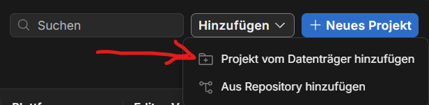
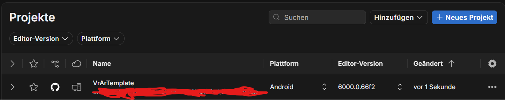

# Meta Quest VR Template (Unity)

A minimal Unity project for building apps for Meta Quest headsets (Quest 2, 3, 3S, Pro).
It includes only the basics. When you open it, a **Setup Checklist** guides you through everything that is still missing.

| | |
|---|---|
| **Unity version** | **6000.0.66f2** (Unity 6 LTS), with **Android Build Support** |
| **Meta SDK** | Meta XR Core SDK + Meta XR Interaction SDK (installed from the checklist) |
| **Platform** | Android (Meta Quest) |

---

## Step-by-step guide for new users

### What you need

- A Windows PC (macOS works too, but this guide uses Windows)
- A Meta Quest headset that is charged and set up
- A **USB-C cable that can transfer data** (some charging-only cables don't work; the Quest's own cable or a Link cable is safest)
- A smartphone with the **Meta Horizon** app, signed in to the same Meta account as the headset
- About 15 GB of free disk space

---

### 1. Install Unity Hub

1. Go to <https://unity.com/download> and download **Unity Hub**.
2. Run the installer and keep the default settings.
3. Start Unity Hub.

<!-- SCREENSHOT: Unity download page -->

### 2. Sign in and get a license

1. In Unity Hub, click **Sign in** (top left) and sign in or create a free Unity account.
2. Unity Hub will ask you to add a license. Choose **Get a free personal license** (or your university/company license if you have one).

<!-- SCREENSHOT: Unity Hub sign-in -->
<!-- SCREENSHOT: Licenses → Add → Free personal license -->

### 3. Install the right Unity Editor

You need exactly **Unity 6000.0.66f2** with the Android modules.

1. In Unity Hub, go to **Installs** → **Install Editor**.
2. Find **6000.0.66f2**. If it isn't listed, open the **Archive** tab, or use this link in your browser:
   `unityhub://6000.0.66f2/b20bc5da3050`
3. On the module screen, tick:
   - ✅ **Android Build Support**
     - ✅ **OpenJDK**
     - ✅ **Android SDK & NDK Tools**
   - (optional) ✅ Microsoft Visual Studio Community, if you don't have a code editor yet
4. Click **Install** and wait. This can take a while.

> **Already have 6000.0.66f2 without Android?** Go to **Installs**, click the ⚙ gear next to the version, choose **Add modules**, and tick the Android items above.

<!-- SCREENSHOT: Install editor → version list -->
<!-- SCREENSHOT: Module selection with Android ticked -->

### 4. Get the template and open it

1. Copy the **VrArTemplate** folder to where you want your project, and rename it (e.g. `MyQuestApp`).
   Use a short path with no special characters, e.g. `C:\Unity\MyQuestApp`.
2. In Unity Hub, go to **Projects** → click the arrow next to **Add** (German: **Hinzufügen**) → **Add project from disk** (German: **Projekt vom Datenträger hinzufügen**).
   

3. Select the project folder (the one that contains `Assets`, `Packages` and `ProjectSettings`) and click **Open / Add**.
4. In the project list, set the **Platform** (German: **Plattform**) column to **Android** and check that the **Editor version** is **6000.0.66f2**. It should look like this:

   

5. Click the project in the list to open it. The first launch takes several minutes because Unity imports everything.

> If Unity Hub shows a warning icon next to the editor version, the right editor isn't installed. Go back to step 3.
>
> Forgot to set the platform? You can also switch it inside Unity: **File → Build Profiles → Android → Switch Platform** (or use **Switch to Android** in the Setup Checklist below).

### 5. Work through the Setup Checklist in Unity

When the project opens, the **VR Template – Setup** window appears automatically.
You can reopen it anytime via the menu **VR Template → Setup Checklist**.

Go from top to bottom until everything is green:

1. **Unity Editor**: shows whether you have the correct version.
2. **Android Build Support**: shows whether the module is installed (see step 3 if not).
3. **Build target**: click **Switch to Android**. This takes a moment.
4. **Meta XR SDK**: click **Install Meta XR Core + Interaction SDK**. Unity downloads the packages and recompiles, which can take a few minutes.
   If Unity asks you to restart or to enable new backends/plugins, click **Yes / Restart**.
   Then click **Open Meta Project Setup Tool** and press **Fix All** (and **Apply All** if shown), on the **Android** tab, until nothing red is left.
5. **Quest player settings**: click **Apply Quest player settings**.
6. **Starter scene**: click **Create starter scene**. This creates `Assets/_Project/Scenes/Main.unity` with a VR camera rig, a floor, a light and a cube.

> **XR Plug-in Management:** If the Project Setup Tool doesn't do it for you, open **Edit → Project Settings → XR Plug-in Management**, select the **Android** tab (the Android robot icon), and tick **OpenXR** (with the *Meta Quest* feature group) or **Oculus**, whichever the Meta tool recommends.

<!-- SCREENSHOT: Setup Checklist window -->
<!-- SCREENSHOT: Meta Project Setup Tool → Fix All -->

### 6. Enable Developer Mode on the Quest

You only need to do this once per headset.

1. **Create a developer organization** (free): go to <https://developers.meta.com/horizon/manage/organizations>, sign in with your Meta account, and create an organization (any name works).
   Meta may ask you to verify your account (with two-factor authentication or a payment method).
2. On your phone, open the **Meta Horizon** app → **Menu → Devices** → select your headset.
3. Go to **Headset settings → Developer mode** and turn it **on**.
4. **Restart the headset** (hold the power button → Restart).

<!-- SCREENSHOT: Meta Horizon app → Devices -->
<!-- SCREENSHOT: Developer mode toggle -->

### 7. Connect the Quest and allow USB debugging

1. Put on the headset and connect it to the PC with the USB-C cable.
2. A popup **"Allow USB debugging?"** appears in the headset. Tick **Always allow from this computer** and click **Allow**.
   (If you don't see it, unplug and replug the cable while wearing the headset, or check your notifications.)
3. If a second popup asks about **file access** or **Quest Link**, you can dismiss it. It isn't needed for building.

> **Optional but helpful:** Install **Meta Quest Developer Hub (MQDH)** from <https://developers.meta.com/horizon/downloads/package/oculus-developer-hub-win>.
> It shows whether your headset is connected, installs the USB driver if Windows doesn't recognise the headset, and lets you cast the headset view to your PC.

<!-- SCREENSHOT: "Allow USB debugging" popup in headset -->

### 8. Build and Run

1. In Unity, open the starter scene `Assets/_Project/Scenes/Main.unity` (or your own scene).
2. Open **File → Build Profiles** (older versions: **File → Build Settings**).
3. Select **Android**. Make sure your scene is listed under **Scene List** and ticked. If it isn't, click **Add Open Scenes**.
4. Under **Run Device**, click **Refresh** and select your Quest (it shows as *Oculus Quest …* or *Meta Quest …*).
   - If it isn't listed, check step 7 (cable, USB debugging popup).
5. Click **Build And Run**.
6. Choose or create a folder for the build, e.g. `Builds/`, and enter a file name like `MyQuestApp.apk`.
7. Wait. **The first build takes a long time** (5–15 minutes). Later builds are much faster.
8. The app starts automatically in the headset. 🎉

<!-- SCREENSHOT: Build Profiles window with Android + Run Device -->
<!-- SCREENSHOT: App running in headset -->

### 9. Find your app again in the headset

In the headset, open **Library** (Apps), then change the filter at the top right from *All* to **Unknown sources**. Your app is listed there.

---

## Troubleshooting

| Problem | Solution |
|---|---|
| Quest not shown under *Run Device* | Use a data-capable USB-C cable; accept the *Allow USB debugging* popup in the headset; check that Developer Mode is on and restart the headset; install MQDH (driver). |
| Device shows as *unauthorized* | Put on the headset and accept the USB debugging popup. If it doesn't appear, unplug and replug the cable. |
| "Android Build Support not installed" | Unity Hub → Installs → ⚙ → Add modules → Android Build Support + OpenJDK + SDK & NDK. |
| Meta SDK install fails | Check your internet connection. Alternatively: **Window → Package Manager → My Registries → Meta XR** → install *Meta XR Core SDK* manually. |
| App shows only black / runs as a flat window | Run the **Meta Project Setup Tool → Fix All** again and check **XR Plug-in Management → Android tab**, where a provider must be ticked. |
| Gradle / build errors | Make sure the project path is short and has no special characters or umlauts. Delete the `Library` folder (with Unity closed) and reopen. |
| Unity asks to update the project to a newer version | Prefer the recommended version (6000.0.66f2). Upgrading usually works but is untested. |

---

## Project structure

```
Assets/
  _Project/
    Editor/      Setup checklist (TemplateSetupWindow.cs), editor-only
    Scenes/      Your scenes (starter scene: Main.unity)
    Scripts/     Your runtime scripts
    Prefabs/
    Materials/
Packages/
  manifest.json  Unity packages + Meta XR scoped registry
ProjectSettings/
  ProjectVersion.txt   Pins the Unity version
```

You can delete the `.gitkeep` files once the folders have content.

---

## For maintainers: updating the template

- **Unity version:** change `ProjectSettings/ProjectVersion.txt` **and** the constants `RecommendedEditor` / `RecommendedEditorChangeset` at the top of `Assets/_Project/Editor/TemplateSetupWindow.cs`.
  The changeset is the 12-character hash in the Unity Hub install link (`unityhub://<version>/<changeset>`).
- **Meta SDK:** the checklist installs the latest version compatible with the editor from Meta's registry (`https://npm.developer.oculus.com`, scope `com.meta.xr`). To pin a version, add e.g. `"com.meta.xr.sdk.core": "209.0.0"` to `Packages/manifest.json`.
- Tested with Unity 6000.0.66f2 + Meta XR Core / Interaction SDK 209.0.0 (opens, compiles for Android, and creates the starter scene).

---

## License

[MIT](LICENSE). Feel free to use this template for your own projects.
